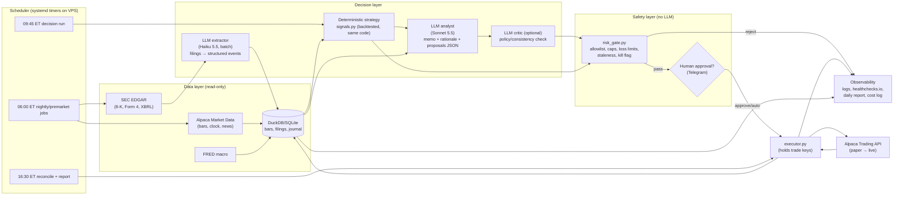

# 04: Overlooked Edges and an MVP Blueprint for a Solo AI Trading Agent

*Researched 2026-11-03. Package versions were pulled live from PyPI on that date. Prices come from vendor pages where I could reach them and from third-party pages where I couldn't; each figure says which. Treat every price as something to re-check before you pay.*

**Confidence tags:** **[Strong]** = peer-reviewed or replicated, or an official vendor document. **[Moderate]** = a credible working paper or a consistent set of secondary sources. **[Weak/Hype]** = self-reported, a small sample, a marketing page, or contradicted elsewhere.

---

## TL;DR

1. **For a solo builder, the dependable edges are mostly defensive.** They come from avoiding losses rather than from predicting prices. The ones that make real money are: (a) not making behavioural errors (investors lose about 1.2 percentage points a year to bad timing, per Morningstar); (b) tax alpha from tax-loss harvesting (about 0.8–1.1% a year in research, and only in taxable accounts); (c) position sizing and risk limits that keep you from blowing up; (d) honest validation (walk-forward testing, deflated Sharpe ratio) so you never deploy an overfit strategy. Each one is unglamorous, can be automated, and is rare among hobby bots.
2. **The research strongly supports using LLMs to read, filter, extract and explain, and does not support using them to predict prices.** In LLM backtests, results are inflated by memorisation ("parametric look-ahead bias"). Over longer windows, LLM trading strategies stop beating buy-and-hold. Multi-agent "debate" has no reliable advantage, and the best-controlled ablation I found shows it *lowering* Sharpe. The well-known "GPT beats analysts" paper was **withdrawn**.
3. **Cheap alternative data is real, but the edges in it are small or have decayed.** That covers EDGAR, Form 4, 13F, Congress trades, transcripts and news. Opportunistic insider *buying* has the best academic support. Copying Congress trades does **not** beat the market after the STOCK Act. Post-earnings drift (PEAD) has mostly disappeared in large caps.
4. **2026 changes worth knowing about:**
   - **The FINRA Pattern Day Trader rule and its $25k minimum are gone.** The SEC approved the change on 2026-04-14, it took effect around 2026-06-04, and firms may transition until 2027-10-20.
   - Alpaca's official MCP server is at v2.4.0 with 65 tools and **defaults to paper trading**.
   - IBKR runs an official hosted MCP endpoint.
   - Polygon has been renamed **Massive**.
   - Claude Haiku 5.5 costs $0.10/$0.50 per million tokens, which makes LLM filtering of every filing nearly free.
5. **Recommended MVP:** Python, Alpaca paper trading, Alpaca free data plus EDGAR, and a **deterministic** rules strategy for allocation, sizing and risk. The LLM writes daily research notes, filters filings and explains every trade, but can only *propose* orders. A hard-coded risk gate and an optional human approval step stand between the LLM and the broker. It runs on cron on a small VPS (or GitHub Actions for jobs that don't depend on timing). **It costs about $5–15 a month.**

---

# PART A: Under-used opportunities, with evidence

## A1. Behavioural error removal is the biggest edge for an individual and is free to capture  [Strong]

- **Morningstar's "Mind the Gap 2025":** over the 10 years to 2025-12-31, the average dollar in US funds earned **8.7%/yr against 9.9%/yr for the funds themselves**. That is a gap of about 1.2 percentage points a year, roughly 12% of total return. The gap comes from the timing and size of buys and sells, and it gets larger as volatility rises (active funds 1.6 pp, index funds 1.1 pp). https://www.morningstar.com/business/insights/research/mind-the-gap-2025
- **Day traders:**
  - Barber & Odean looked at 66k Schwab accounts from 1991–96. The most active traders earned 11.4%/yr while the market returned 17.9%.
  - Chague, De‑Losso & Giovannetti studied persistent Brazilian futures day traders: about 97% lost money and only about 1% earned more than minimum wage.
  - Taiwan data shows fewer than 1% of day traders are reliably profitable after fees.
  - Summary: https://quantpedia.com/retail-day-trading-is-an-uphill-battle/, https://www.cnbc.com/2020/11/20/attention-robinhood-power-users-most-day-traders-lose-money.html
- **How this helps the agent:** an autonomous system's main value can be *discipline*. It rebalances on schedule, never panic-sells, never revenge-trades, and enforces cool-down periods. Measure it against a "do nothing / buy-and-hold" baseline, not against zero.
- **Under-used design pattern: the agent as a behavioural firewall.** The LLM explains *why not* to make the trade you were tempted to place. It can also hold an "intent journal" in which every manual override needs a written reason and gets reviewed 30 days later.

## A2. Risk management and position sizing are the edge you can actually control  [Strong as a principle, Moderate on specific techniques]

- **Survival comes first.** Fixed-fraction sizing (risking at most 0.5–1% of equity per trade), a cap on gross exposure, a daily loss stop and a max-drawdown kill switch are what separate bots that last from bots that blow up. These rules are cheap to code, and hobby repos rarely include them. Most TradingAgents-style projects output only BUY/SELL/HOLD with no portfolio-level risk budget.
- **Volatility targeting** means scaling exposure inversely to recent volatility.
  - Moreira & Muir (2017) found positive alphas.
  - **Cederburg, O'Doherty, Wang & Yan (2019)** find that volatility-managed portfolios do *not* systematically beat unmanaged ones out of sample (53 vs 50 wins), and that the spanning regressions are unstable. https://www.lehigh.edu/~xuy219/research/COWY.pdf
  - **What this means for you:** use volatility scaling to **control risk** (smoother drawdowns, consistent risk per position). Don't count on it to raise returns.
- **Kelly sizing:** full Kelly is far too aggressive when your edge estimate is noisy. Use ¼ Kelly or less, or just fixed-fractional sizing. (This is standard practitioner guidance; I didn't search for a specific citation.)
- **Practical tools:**
  - `riskfolio-lib` 7.4.0 (2026-10-04) for HRP and risk-parity allocation.
  - `quantstats` 0.0.86 and `pyfolio-reloaded` 0.10.2 (2026-11-02) for tearsheets.

## A3. Tax-aware automation: real alpha that only works in a taxable account  [Strong]

- **Chaudhuri, Burnham & Lo (FAJ 2020)** use CRSP data from 1926–2018. Tax-loss harvesting (TLH) is worth about **1.08%/yr before the wash-sale rule and about 0.82%/yr with it**, or roughly 0.95%/yr after transaction costs in the CFA summary. It pays most when markets are volatile, falling or highly dispersed. https://dspace.mit.edu/handle/1721.1/135992, https://rpc.cfainstitute.org/research/financial-analysts-journal/2020/empirical-evaluation-tax-loss-harvesting-alpha
- **Vanguard (Dickson, 2024)** estimates 0.47–1.27%/yr. The biggest driver is **reinvesting the tax savings**. https://corporate.vanguard.com/content/dam/corp/research/pdf/tax_loss_harvesting_why_a_personalized_approach_is_important.pdf
- **Direct indexing works better than harvesting ETFs.** Israelov & Lu (2023) found that the 5th-percentile result for direct-stock harvesting beat the *average* ETF result. AQR's paper on the topic: https://www.aqr.com/-/media/AQR/Documents/Journal-Articles/AQR-The-Tax-Benefits-of-Direct-Indexing.pdf
- **Why this suits indie builders:** fractional shares at Alpaca or Schwab make a 50–100 stock "mini direct index" possible with a few thousand dollars. The logic is deterministic and easy to test: lot-level cost basis, a loss threshold, a wash-sale calendar that covers *all* your accounts including IRAs, and a correlated replacement security.
- **Limitations:**
  - It doesn't help a student with a small IRA, Roth account or ISA, or with low income (the 0% long-term capital gains bracket).
  - The value is mostly deferral, and it decays as the cost basis ratchets down.
  - US-specific: wash-sale rules apply across your accounts.
- **Verdict:** a high-value v2 feature if the user has a taxable account. Skip it otherwise.

## A4. Honest validation: the cheapest "edge" is not fooling yourself  [Strong]

- **Deflated Sharpe Ratio** (Bailey & López de Prado, *JPM* 2014) corrects for selection bias across many trials and for non-normal returns. https://papers.ssrn.com/abstract=2460551
- **Probability of Backtest Overfitting (PBO) via CSCV** (Bailey, Borwein, López de Prado & Zhu, *J. Comp. Finance*) estimates how likely it is that the best in-sample configuration lands below the median out of sample. https://papers.ssrn.com/abstract=2326253. An R package `pbo` exists; the method is also easy to write in Python.
- **Specific to LLMs:**
  - **"Parametric look-ahead bias":** models remember what happened after a given date. FinCAD cuts in-sample backtest returns by up to 67% on memorised dates. https://arxiv.org/abs/2605.24564
  - Li et al. found that LLM strategies lose their edge over 20 years and 100+ symbols. They are too conservative in bull markets and too aggressive in bear markets. https://arxiv.org/abs/2505.07078
  - On StockBench (DJIA, Mar–Jul 2025), most LLM agents fail to beat buy-and-hold. https://arxiv.org/html/2603.27539v1
  - **Rule:** test an LLM signal only on data *after the model's knowledge cutoff*, or treat the result as untrustworthy.
- **Under-used practice:** keep a **trial ledger** that logs every backtest you run. You need it to compute DSR and PBO, and almost nobody keeps one.

## A5. Use LLMs for research, filtering and explanation, not prediction  [Moderate to Strong]

**Evidence for prediction is thin or retracted:**
- Lopez‑Lira & Tang ("Can ChatGPT Forecast Stock Price Movements?", v6, Oct 2025) find that headline sentiment predicts next-day returns. The effect is strongest in small caps and on the short side, and is consistent with information diffusing slowly. The authors themselves call the correlation "very small but statistically significant", and expect it to shrink as LLM use spreads. https://arxiv.org/abs/2304.07619
- **Kim, Muhn & Nikolaev's "Financial Statement Analysis with LLMs" was withdrawn from arXiv in Feb 2025** after a co-author found data inconsistencies while trying to replicate it. Don't cite its "beats analysts" claim. https://arxiv.org/abs/2407.17866v3
- **Live real-money contests:** in nof1 Alpha Arena Season 1 (crypto), 4 of 6 frontier LLMs lost money. In Season 1.5 (US equities), the winner made about +12%. The samples are tiny (weeks long, one run per model) and statistically meaningless. https://forklog.com/en/news/ai-model-grok-4-2-triumphs-in-trading-tournament

**Where LLMs clearly add value, and few people use them this way:**
- Turning unstructured text into structured fields: 8-K item classification, guidance changes, risk-factor diffs between 10-Ks, insider-transaction footnotes (10b5-1 plan or not), and tone shifts in earnings calls.
- **Screening and triage:** cutting 300 daily filings to the 5 a human or rule should look at.
- **Explaining:** a plain-language reason for every order, attached to the trade log. This helps you audit the system and learn from it.
- **Code and test generation** for the deterministic strategy.
- **Pre-trade checks:** "Does this order violate any rule in policy.md?" A second, independent check alongside the hard-coded gate, never in place of it.

## A6. Alternative data that is now cheap or free: what the evidence says

| Source | Cost | Evidence of edge | Verdict |
|---|---|---|---|
| **SEC EDGAR** (submissions, XBRL companyfacts, full-text) | Free, no key. Max 10 req/s; a User-Agent header with contact email is required. https://www.sec.gov/os/accessing-edgar-data | It's infrastructure, not a signal. Point-in-time fundamentals by filing date remove one source of look-ahead bias. | **Use.** `edgartools` 5.62.1 (2026-10-23) is the best Python wrapper. |
| **Form 4 insider trades** | Free on EDGAR | **Cohen, Malloy & Pomorski ("Decoding Inside Information", JF 2012):** *opportunistic* insider trades earn about 82 bp/month value-weighted abnormal returns. *Routine* trades earn about 0. Clustered purchases are followed by about 2.1% the next month. https://papers.ssrn.com/abstract=1692517 [Strong but decaying; mostly small caps; costs matter] | **Best academically supported cheap signal.** Use purchases only, filter out 10b5-1 plans, and classify routine vs opportunistic using each insider's own history. |
| **13F** | Free | Filed 45 days after quarter-end and long-only, so it's stale. "Clone the gurus" results are mixed. | Low priority; idea generation only. |
| **Congress trades** (STOCK Act) | Free (House/Senate disclosures); Quiver has a free tier | **Baulkaran & Jain, *Economics Letters* 2025:** neither NANC nor KRUZ significantly beats the market. https://ideas.repec.org/a/eee/ecolet/v250y2025ics0165176525001004.html The 2004 senators' result came before the STOCK Act. | **Hype.** Fine as a learning project or a sentiment feature, but don't expect alpha. |
| **Earnings call transcripts** | Paid (FMP, Massive add-ons, Quartr); some are free in EDGAR 8-K exhibits | Tone and Q&A features show some predictability in the literature (not verified here). | A good LLM extraction exercise; the edge is unproven for retail. |
| **News headlines** | Alpaca includes a news API; Tiingo and Massive sell feeds | Lopez‑Lira & Tang: small, fast-decaying, mostly small-cap and short side. | Use for risk flags ("halt, investigation, going-concern"), not for alpha. |
| **Options flow** ("unusual activity") | $30–$100+/mo vendors | Mostly marketing. Order-flow research uses institutional-grade signed data that retail feeds don't have. | **Hype for retail.** Skip in v1. |
| **PEAD (earnings drift)** | Free-ish | Large-cap PEAD has been about zero since around 2006. It persists in small caps but isn't significant after costs (2020–24 thesis). A 2026 paper blames declining signal informativeness. https://journals.sagepub.com/doi/10.1177/0148558X261439734 | Marginal. Possibly in small caps with careful cost modelling. |

## A7. Event-driven strategies  [Moderate]
- Event-driven setups (insider clusters, 8-K items such as 1.01 material agreements, 2.02 results and 5.02 executive changes, index additions, spin-offs, buybacks) are where **LLM extraction plus a simple rule** fits naturally. The LLM classifies the event, and a backtested rule decides whether to act. Run the backtests with filing-time timestamps, not "date of period".
- **Main risk:** these edges live in small caps, where spreads, borrow costs and slippage eat them. Model costs pessimistically.

## A8. Multi-agent debate and critic architectures  [Weak/Hype as a performance edge]
- TradingAgents (arXiv 2412.20138) reports better results than baselines, but the backtest was short and self-reported, with no live validation.
- **Market Regime Council (arXiv 2605.24490):** the debate stage *consistently lowered Sharpe* relative to the best single specialist, and plain math (Shapley-weighted) aggregation beat LLM synthesis at every stage.
- **Nguyen & Pham (arXiv 2603.27539):** whether coordination helps depends on protocol design, so they propose a "Coordination Breakeven Spread" metric to test value net of costs.
- **Takeaway:** a **single critic or verifier that checks policy compliance and data-citation correctness** is worth having. Debate as a source of alpha is not proven, and it multiplies token cost by 5–10×.

## A9. Broker MCP servers  [Strong for convenience, a risk if misused]
- **Alpaca MCP Server v2:** PyPI `alpaca-mcp-server` 2.4.0 (2026-10-12), 65 tools. `ALPACA_PAPER_TRADE=true` by default, and `ALPACA_TOOLSETS` limits which tools are exposed. Install with `claude mcp add alpaca --scope user --transport stdio uvx alpaca-mcp-server`. https://docs.alpaca.markets/docs/alpaca-mcp-server
- **IBKR:** an official hosted MCP at `https://api.ibkr.com/v1/api/mcp-public`, open since 2026-07-29 to any MCP client. Reviews describe execution staying outside the AI session (you confirm in IBKR); verify this yourself. https://www.stockbrokers.com/guides/ai-agent-brokers
- **Recommendation:** MCP is great for **interactive** research in Claude Code or Desktop. For an **autonomous** agent, do *not* hand the LLM an MCP tool that can place orders. Expose only read tools plus a custom `propose_order` tool that writes to a queue your risk gate checks. That boundary is the single most important guardrail.

## A10. Prediction markets  [Moderate; a niche]
- **Bürgi, Deng & Whelan, "Makers and Takers: The Economics of the Kalshi Prediction Market"** (CEPR DP20631, 2025/26):
  - Kalshi shows a favourite-longshot bias: cheap contracts are overpriced.
  - Average pre-fee contract return is about −20%. **Takers lose about 32% and makers about 10%.**
  - The bias is shrinking over time.
  - https://www.karlwhelan.com/Papers/Kalshi.pdf
- **Implications:**
  - Don't buy longshots.
  - Making markets with limit orders on favourites is the structurally better side.
  - LLMs could help price event questions, but that is unproven.
- **Access:**
  - Kalshi has a REST/WebSocket API, a demo environment, and signed API keys.
  - Polymarket International is close-only for US users. Polymarket US is a separate CFTC-regulated venue.
  - Fees change often; check docs.kalshi.com.
- This is a reasonable "v3 sandbox" for a student: small stakes, binary outcomes, and fast feedback on calibration.

## A11. Cheap small-model inference  [Strong, verified pricing]
Anthropic list prices per million tokens (input/output) from the official skill reference, cached 2026-10-06:

| Model | Price | Use |
|---|---|---|
| Claude Haiku 5.5 | $0.10 / $0.50 | Bulk filing classification |
| Claude Sonnet 5.5 | $2 / $10 | Daily memo writing |
| Claude Opus 5.5 | $4 / $20 | Weekly deep review |

- The Batches API is 50% off. Prompt-cache reads cost about 10% of input.
- **Worked example:** classifying 300 filings a day at about 3k tokens each is about 0.9M input tokens a day. On Haiku 5.5 that's about **$0.09/day, or roughly $2/month**, and about half that with batching.
- A local open-weight model (Ollama) is cheaper still, but has lower extraction accuracy and needs hardware; not worth it for v1.

## A12. Regulatory change: the PDT rule is gone  [Strong]
- **What changed:** the SEC approved FINRA's Rule 4210 amendments (accelerated approval 2026-04-14). The "pattern day trader" designation and its $25,000 minimum were replaced by an intraday-margin framework, effective around 2026-06-04, with firms allowed to transition until 2027-10-20. https://public-inspection.federalregister.gov/2026-07485.pdf, https://www.kslaw.com/insights/articles/finra-adopts-sweeping-changes-to-margin-requirements-for-day-trading
- **What it means:** a small account can technically day-trade now. That **removes a guardrail that used to protect beginners**, so the agent should set its own trade-frequency limit, since the evidence in A1 says frequent trading destroys returns. Check your broker's transition status, because firms may still apply the old rules until 2027.

---

# PART B: MVP technical blueprint (as of Nov 2026)

## B1. Brokers

| Broker | Paper trading | API / SDK (version) | Notes |
|---|---|---|---|
| **Alpaca** (recommended for v1) | Yes, free and separate keys | `alpaca-py` 0.44.0 (2026-08-11); MCP 2.4.0 | Commission-free US stocks/ETFs, fractional shares, crypto, options. **Paper fills differ from live:** they fill at NBBO, add random partial fills, and don't model market impact, queue position or latency slippage; one source says dividends aren't simulated either. https://forum.alpaca.markets/t/slippage-paper-trading-vs-real-trading/2801 |
| **Interactive Brokers** | Yes (paper account) | `ib_async` 2.1.0 (2025-12-08; the maintained fork of `ib_insync`, last release 2023). TWS/IB Gateway required; also a Client Portal Web API and an official MCP endpoint | Best market coverage and global access. The gateway needs daily re-auth or an IBC wrapper, which adds ops work. Best for v2 if you need non-US markets. |
| **Schwab Trader API** | **No meaningful paper environment** | `schwab-py` 1.5.1 (2025-06) | Needs two approval steps (developer account plus "Trader API – Individual"), a few days each. Refresh tokens **expire every 7 days**, forcing a manual browser re-login, so it's poor for unattended bots. Limit is about 120 req/min. https://lumibot.lumiwealth.com/brokers.schwab.html |
| **Tradier** | Free sandbox (`api.sandbox.tradier.com/v1`) | REST | Good for options. Its pricing plans change; check tradier.com. |
| **Coinbase Advanced** (crypto) | No real sandbox (verify) | `coinbase-advanced-py` 1.8.4 (2026-06) | **US fees after the 2026-09-16 restructure: 0.50% maker / 0.90% taker at the entry tier.** That is very expensive for an active bot. https://www.securities.io/coinbase-lowers-advanced-trading-fees-with-tiers-starting-at-10-000/ |
| **Kraken** (crypto) | A futures demo exists (verify for spot) | `python-kraken-sdk` 3.5.1 (2026-09-28); or `ccxt` 4.5.91 for a unified API | Usually cheaper than Coinbase for spot. Use `ccxt` if you want to be able to switch exchanges. |
| **Kalshi** (prediction) | Demo environment | `kalshi-python` 2.1.4 / REST | v3 experiment only. |

**Pick for v1:** Alpaca paper. It has the simplest auth (static keys), a free paper account, an official SDK and MCP, and a `market clock` endpoint for trading-calendar checks.

## B2. Market data

| Source | Cost | Notes |
|---|---|---|
| **Alpaca Basic** | $0 | IEX-only real-time, 15-min delay for SIP via the API, 7+ years of history, 200 calls/min, 30 websocket symbols. **Fine for daily-bar strategies.** https://alpaca.markets/data |
| **Alpaca Algo Trader Plus** | $99/mo | All US exchanges in real time, unlimited calls, real-time OPRA options data. Only needed for intraday trading. |
| **Massive (formerly Polygon.io)** | Basic $0; Starter about $29; Developer about $79 (some sources say $99); Advanced about $199/mo. Third-party figures for individuals as of Jul–Sep 2026. | Renamed 2025-10-30; `api.polygon.io` and `api.massive.com` run in parallel. Strong historical tick and aggregate data, plus flat files. https://apicostcalc.com/blog/polygon-massive-rebrand-api-pricing.html |
| **Tiingo** | Free tier; Power about $30/mo for individuals (third-party, Oct 2026) | Clean EOD data and fundamentals; real-time is IEX-only. Good value for daily backtests. `tiingo` 0.16.1. |
| **yfinance** | Free | v1.7.0 (2026-08). **Unofficial scraper.** It hits frequent `YFRateLimitError`/429 errors (including after IP changes) and has no SLA. Use it for prototyping in notebooks only, **never in the production loop**. https://github.com/ranaroussi/yfinance/issues/2422 |
| **SEC EDGAR** | Free | See A6. `edgartools` 5.62.1, `sec-edgar-downloader` 5.1.0. |
| **FRED** | Free | Macro data (rates, VIX proxies) for regime filters. |
| **Calendars** | Free | `pandas-market-calendars` 5.6.0 / `exchange_calendars` 4.13.2 for holidays and half-days. |

**Survivorship bias:** free data covers *current* tickers. For honest backtests of universe-selection strategies you need delisted securities (Massive flat files, Norgate, or QuantConnect's data), or restrict the v1 universe to ETFs and large caps.

## B3. Backtesting frameworks

| Framework | Version / date | Best for | Caveats |
|---|---|---|---|
| **vectorbt** (open source) | 1.2.0 (2026-10-19) | Fast parameter sweeps, portfolio-level daily strategies, and **feeding the DSR/PBO trial ledger** | Execution is idealised unless you add slippage yourself, and path-dependent logic is awkward. The PRO edition is invite-only and paid. |
| **NautilusTrader** | 1.231.0 (2026-08-02) | An event-driven, Rust-core engine where **the same strategy code runs in backtest and live** (Alpaca, IBKR, Binance and other adapters) | Steep learning curve; overkill for a daily rebalancer. **Best v2 choice.** |
| **LEAN / QuantConnect** | `lean` CLI 1.0.233 (2026-10-27) | Institutional-quality data including delisted securities, local or cloud | Cloud Researcher tier is about $84/mo (official page); live nodes from about $24/mo (third-party). C# core. |
| **Zipline-reloaded** | 3.2.1 (2026-10-25) | Pipeline-style factor research (from Stefan Jansen's ML4T book) | Data bundles take effort to set up. |
| **backtesting.py** | 0.6.6 (2026-07) | Simple single-asset strategies, easy to learn | Single instrument only. |
| **bt** | 1.4.1 (2026-10) | Tree-structured allocation and rebalancing strategies | Good fit for an ETF rotation MVP. |
| **backtrader** | 1.9.78.123 (**last release 2023-04**) | Lots of tutorials | **Unmaintained; avoid for new builds.** |

**MVP pick:** `vectorbt` (or `bt`) for research and sweeps, plus your own simple daily simulator that shares the same `signals.py` used live. Move to NautilusTrader in v2 if you go intraday.

## B4. LLM and agent layer

| Option | Version | When to use |
|---|---|---|
| **Anthropic Python SDK + tool use** (`anthropic` 2.4.0, 2026-11-02) | Tool runner via `client.beta.messages.tool_runner`; structured outputs via `output_config.format` / `client.messages.parse()` | **v1 default.** You own the loop, every tool is yours, and it's easy to add an approval gate. |
| **Claude Agent SDK** (`claude-agent-sdk` 0.2.177, 2026-11-03) | Claude Code as a library: built-in Read/Write/Bash/WebSearch, MCP, hooks, subagents, permissions | Good for a **research analyst** agent that writes notes to disk or the repo and reads EDGAR. Use `PreToolUse` hooks and permission rules to block order tools. https://code.claude.com/docs/en/agent-sdk |
| **Claude Managed Agents** (beta) | Anthropic hosts the loop and sandbox; scheduled deployments | An option if you don't want to run a server. Keep the order path *outside* it regardless. |
| **LangGraph** | 1.2.19 (2026-10-30) | Explicit state machine and graph workflows; checkpointing; provider-agnostic | Use it if you want TradingAgents-style graphs or several providers. |
| **TradingAgents** (TauricResearch) | v0.7.1 (2026-10), Apache‑2.0, about 120k stars; built on LangGraph | Analyst team (fundamentals, sentiment, news, technical), bull and bear researchers, trader, risk, then portfolio manager. **Read it for architecture ideas, not as a trading engine.** It is research-only; v0.7.1 had to fix "model reading filings dated after the run date", a live example of look-ahead leaks. https://github.com/TauricResearch/TradingAgents |
| **virattt/ai-hedge-fund** | n/a | A similar educational multi-agent demo. |

**Model routing for cost:**
- **Haiku 5.5** for bulk extraction and classification.
- **Sonnet 5.5** for the daily memo and order rationale.
- **Opus 5.5** for weekly review and post-mortems.

Run overnight EDGAR processing through the Batches API (50% off), and cache the system prompt and policy document.

## B5. Scheduling, hosting and ops

| Option | Cost | Fit |
|---|---|---|
| **Small VPS + systemd timers / cron** | Hetzner CX23 about €4–6/mo after 2026's two price rises (third-party sources disagree; check hetzner.com). Similar: DigitalOcean, Vultr, Oracle Free Tier. | **Recommended.** Reliable timing, keeps state, can run IB Gateway later. |
| **GitHub Actions `schedule`** | Free (public repo) or included minutes | **Unreliable timing:** delays of 3–7 hours and dropped runs are reported, and schedules are disabled after 60 days without repo activity (public repos). https://github.com/orgs/community/discussions/201472, https://docs.github.com/en/actions/how-tos/manage-workflow-runs/disable-and-enable-workflows. Fine for **nightly EDGAR batch jobs and reports**; **not** for order placement. |
| **Raspberry Pi / home PC** | About $0 | Okay for paper trading; power and network outages are a risk for live trading. |
| **QuantConnect cloud live node** | About $24+/mo plus seat | Managed alternative if you write in LEAN. |

**Observability (minimal and cheap):**
- Structured JSON logs plus a **SQLite or DuckDB "trade journal"** with tables: signals, proposals, risk_decisions, orders, fills, llm_calls (prompt hash, model, tokens, cost), daily_equity.
- A **dead-man's switch:** healthchecks.io (free tier), pinged at the end of each job, alerts if a run is missed.
- **Notifications:** a Telegram or Discord bot, or email, for the daily summary, every proposal (for approval), every rejection, and kill-switch trips.
- **LLM tracing:** log the SDK's `usage` fields per call. Add OpenTelemetry or Langfuse later.
- A **daily reconciliation** that checks broker positions against the journal and halts on any mismatch.

## B6. Guardrails and kill switches (put them in code, not in prompts)

Hard rules, enforced by a deterministic `risk_gate.py` that the LLM cannot change:
1. **Allowlist** of tickers: v1 is about 10–30 liquid ETFs and large caps. Anything else is rejected.
2. **Asset and type limits:** cash account only, **no margin, no shorting, no options, no crypto in v1**. Only market-on-open or limit orders with a price collar (for example, within 1% of the last price).
3. **Position cap:** at most 10% of equity per name (v1), at most 100% gross exposure, at least 5% cash floor.
4. **Order sanity:** max notional per order (say $500 in the first live month), max orders per day (for example 10), and no more than one order per symbol per day. Since the PDT backstop is gone, enforce your own day-trade limit.
5. **Daily loss limit:** if equity falls more than 2% from the day's open, cancel open orders and stop trading for the day.
6. **Max drawdown kill switch:** if drawdown from the high-water mark exceeds 10–15%, liquidate to cash or freeze, and require a manual re-arm.
7. **Data staleness check:** if the latest bar is older than expected, or the broker clock reports the market closed, do nothing.
8. **Fail-closed:** any exception means no trade. An idempotency key (`client_order_id`) on every order prevents duplicate submissions.
9. **Kill-switch mechanisms:** (a) a `KILL` file or env flag checked before every order; (b) a Telegram `/kill` command; (c) revoke the API key in the broker dashboard as the last resort; (d) Alpaca `DELETE /v2/orders` and `DELETE /v2/positions` (cancel all orders, close all positions) wrapped in `panic.py`.
10. **Human-approval mode** (the v1 default for live trading): each proposal goes to Telegram with its rationale and risk check, and nothing executes without an Approve tap. Unapproved proposals expire at a cutoff. Graduate to "auto below $X notional" only after N weeks without incident.
11. **Separation of keys:** the LLM process holds only *read* keys or none at all. The executor process holds the trading keys. Live keys and paper keys live in different env files, and live mode requires an explicit `--live` flag plus a config hash check.
12. **Prompt-injection hygiene:** filings and news are untrusted text. The LLM output is a JSON schema (`strict` tool or structured output) carrying a proposal, and free text never reaches the executor.

## B7. Architecture



Text version: **Scheduler → (Data ingest → DB) → Deterministic signals + LLM extraction/memo → proposals (JSON) → [LLM critic] → risk_gate (hard rules) → [human approval] → executor → broker → fills → journal → reconcile → report and alerts.** The LLM never holds a trading key and never talks to the broker directly.

## B8. (1) A 2–4 week MVP scope

**Goal:** a paper-trading agent that runs every trading day without supervision, trades a *simple, backtested* strategy, uses an LLM for research and explanation, and can't do anything dangerous.

- **Week 1: foundations and baseline strategy**
  - Repo skeleton (`uv`, Python 3.12), config, `.env.paper`, pre-commit, pytest.
  - Data ingest: Alpaca daily bars for an allowlist of about 15 ETFs (SPY, QQQ, IWM, EFA, EEM, TLT, IEF, GLD, DBC, VNQ, XLK…) into DuckDB, plus the calendar.
  - Strategy: **dual momentum / trend-following ETF rotation with volatility-scaled weights**, rebalanced monthly or weekly. It is well documented, rarely trades and is easy to verify.
  - vectorbt backtest from 2008 to now, with costs and slippage, walk-forward, a trial ledger and a DSR computation. Compare against SPY buy-and-hold and 60/40.
- **Week 2: execution and safety**
  - `risk_gate.py` with every rule in B6 and **unit tests for each rule** (the most important tests in the repo).
  - `executor.py` using `alpaca-py` against paper, with idempotent `client_order_id`, limit orders with collars, and reconciliation.
  - Kill switch: file flag, `panic.py`, and a Telegram `/kill`.
  - systemd timers on a VPS, plus a healthchecks.io ping.
- **Week 3: LLM layer**
  - EDGAR fetcher (`edgartools`) for holdings-relevant filings and macro news. Haiku 5.5 classifies them into a strict JSON schema of risk flags.
  - A Sonnet 5.5 daily memo covering: what the strategy wants and why, what changed, any red flags, and a plain-English explanation of each proposed order. Delivered by Telegram and stored in the journal.
  - The LLM may **veto or flag** a trade for human review, but may **not add** trades outside the deterministic signal. That asymmetry is safe.
- **Week 4: hardening and evaluation**
  - Human-approval flow in Telegram, a daily P&L and attribution report, and an LLM cost log.
  - Two weeks of paper results compared with backtest expectations (tracking error, slippage). Write a runbook.
  - **Exit criteria before any live money:**
    - 4–8 weeks of clean paper running.
    - Zero unhandled exceptions.
    - Reconciliation always matches.
    - Kill switch tested.
    - The live account starts tiny (for example $500–$1,000), in approval mode.

**Explicitly out of scope for v1:** intraday trading, options, margin and shorting, crypto, LLM-generated alpha signals, multi-agent debate, and auto-execution without approval on live.

## B9. (2) v2: a personal-use system (months 2–6)

- **Engine:** move signal and execution code to NautilusTrader so backtest and live run the same code, or stay on the simple daily loop if it's working.
- **Strategies (a sleeve-based portfolio, each sleeve with its own risk budget):**
  1. Core: the ETF trend and momentum sleeve from v1.
  2. **Tax-aware mini direct index** (taxable account only): 50–100 large-cap names with fractional shares, a TLH engine (lot tracking, loss threshold, 31-day wash-sale calendar *across all your accounts*, correlated substitute).
  3. **Event sleeve:** opportunistic insider-purchase clusters from Form 4. The LLM classifies routine vs opportunistic and 10b5-1 status; a rule sets entries, exits and sizes. Paper trade it for 3+ months first, and test only after the model's cutoff.
  4. (Optional) A Kalshi demo sleeve to practise probability calibration, with makers only and no longshots.
- **LLM upgrades:**
  - Claude Agent SDK "research analyst" with read-only EDGAR and data MCP tools, writing weekly notes into a repo.
  - An Opus 5.5 weekly post-mortem that compares realised against expected results.
  - A single critic model checks memos for unsupported claims and citation errors.
- **Validation:** an automated PBO/DSR gate in CI. A strategy config can't be promoted to live unless DSR > 0.95 and PBO < 0.2, and it must have paper-traded for at least N weeks.
- **Ops:**
  - A Grafana or Streamlit dashboard on the DuckDB journal.
  - Langfuse or OpenTelemetry tracing for LLM calls.
  - Backups of the journal to object storage.
  - Secrets in a password manager or sops.
- **Broker:** add IBKR via `ib_async` with an IBC-managed gateway if you need international ETFs or better routing. Keep Alpaca for US.
- **Data:** Massive Starter or Tiingo Power if you need cleaner corporate actions or delisted names. Alpaca Algo Trader Plus only if you go intraday.

## B10. (3) Monthly cost estimates (USD, Nov 2026)

| Item | MVP (paper) | v1 live, small | v2 personal |
|---|---|---|---|
| Broker (Alpaca, commission-free stocks/ETFs) | $0 | $0 (plus SEC/FINRA pass-through fees of cents) | $0 (IBKR: small commissions) |
| Market data | $0 (Alpaca Basic + EDGAR + FRED) | $0 | $0–$30 (Tiingo Power) or about $29 (Massive Starter); $99 only if intraday |
| VPS | ~$5–7 (Hetzner CX23 class) | ~$5–7 | ~$7–15 (bigger box for Nautilus or a gateway) |
| LLM API | ~$1–5 (Haiku extraction plus a daily Sonnet memo of about 20k tokens in and 2k out, about $0.06/day) | ~$2–8 | ~$10–40 (agent research loops and weekly Opus reviews) |
| Monitoring (healthchecks.io, Telegram) | $0 | $0 | $0–10 |
| Optional QuantConnect | n/a | n/a | ~$84 Researcher + ~$24/node if you take that route |
| **Total** | **≈ $5–15/mo** | **≈ $10–20/mo** | **≈ $20–100/mo** |

**Sanity check:** at a $5k account, $15/mo is 3.6% a year of drag. **Costs must be small relative to account size**, which argues for low-frequency strategies and cheap models.

## B11. Suggested repo layout

```
trading-agent/
  config/  allowlist.yaml  risk.yaml  strategy.yaml
  src/
    data/      alpaca_bars.py  edgar.py  fred.py  store.py (DuckDB)
    strategy/  signals.py  sizing.py      # pure functions, shared by backtest + live
    llm/       extract.py  memo.py  critic.py  schemas.py  costlog.py
    risk/      risk_gate.py  killswitch.py
    exec/      executor.py  reconcile.py  panic.py
    notify/    telegram.py
    research/  backtest_vbt.py  walkforward.py  dsr_pbo.py  trial_ledger.py
  jobs/        premarket.py  decide.py  eod.py
  tests/       test_risk_gate.py (most important), test_signals.py, test_reconcile.py
  deploy/      systemd/*.timer *.service
```

## B12. Legal and ethical notes
- Trading your own account with your own bot is fine. **Managing other people's money or selling signals** can trigger investment-adviser registration and rules; stay personal-use.
- Data licences: individual and non-professional plans (Alpaca, Massive, Tiingo) **forbid redistribution**. Don't publish a public dashboard showing their raw data.
- Taxes: keep an exportable trade log. Wash-sale rules apply across your accounts (including IRAs).
- If you're a student on a student visa (e.g. US F‑1), check whether active trading counts as unauthorised employment. It usually doesn't for personal investing, but take advice. (Not researched here.)

---

## Hype vs evidence: quick reference

| Claim | Verdict |
|---|---|
| "LLMs can predict stock prices" | **Mostly hype.** There is a small headline-sentiment effect, concentrated in small caps. Backtests are contaminated by memorisation, and the advantage disappears over long samples. |
| "Multi-agent debate makes better trades" | **Unproven.** The best ablation shows debate lowering Sharpe. |
| "Copy Congress / copy 13F" | **Hype** after the STOCK Act; 13F data is stale. |
| "Unusual options flow alerts" | **Hype for retail.** |
| "Insider buying clusters" | **Real but small and decaying**, mostly in small caps. |
| "Tax-loss harvesting / direct indexing" | **Real**, about 0.5–1.1%/yr, in taxable accounts only. |
| "Behavioural discipline" | **Real**, about 1.2 pp/yr for the average fund investor, more for active traders. |
| "Volatility targeting raises returns" | **Mixed**; it reliably smooths risk, but higher returns aren't reliable. |
| "Paper results = live results" | **False.** Alpaca paper trading ignores impact, queue position and latency. |
| "GitHub Actions cron is fine for trading" | **False** for timing-sensitive jobs. |

## Sources (main)
- Morningstar Mind the Gap 2025: https://www.morningstar.com/business/insights/research/mind-the-gap-2025
- Quantpedia (day-trading studies): https://quantpedia.com/retail-day-trading-is-an-uphill-battle/
- Chaudhuri, Burnham & Lo (TLH): https://dspace.mit.edu/handle/1721.1/135992 ; CFA summary https://rpc.cfainstitute.org/research/financial-analysts-journal/2020/empirical-evaluation-tax-loss-harvesting-alpha
- Vanguard TLH 2024: https://corporate.vanguard.com/content/dam/corp/research/pdf/tax_loss_harvesting_why_a_personalized_approach_is_important.pdf
- AQR direct indexing: https://www.aqr.com/-/media/AQR/Documents/Journal-Articles/AQR-The-Tax-Benefits-of-Direct-Indexing.pdf
- Deflated Sharpe: https://papers.ssrn.com/abstract=2460551 ; PBO: https://papers.ssrn.com/abstract=2326253
- Cederburg et al. (vol-managed critique): https://www.lehigh.edu/~xuy219/research/COWY.pdf
- Cohen, Malloy & Pomorski: https://papers.ssrn.com/abstract=1692517 ; https://www.nber.org/digest/apr11/decoding-inside-information
- Baulkaran & Jain (NANC/KRUZ): https://ideas.repec.org/a/eee/ecolet/v250y2025ics0165176525001004.html
- PEAD decline (2026): https://journals.sagepub.com/doi/10.1177/0148558X261439734
- Lopez-Lira & Tang: https://arxiv.org/abs/2304.07619
- Kim/Muhn/Nikolaev (withdrawn): https://arxiv.org/abs/2407.17866v3
- LLM look-ahead / memorisation (FinCAD): https://arxiv.org/abs/2605.24564 ; Li et al. https://arxiv.org/abs/2505.07078 ; Evaluation taxonomy https://arxiv.org/html/2603.27539v1
- Market Regime Council (debate ablation): https://arxiv.org/pdf/2605.24490 ; TradingAgents paper https://arxiv.org/pdf/2412.20138
- Alpha Arena coverage: https://forklog.com/en/news/ai-model-grok-4-2-triumphs-in-trading-tournament
- Kalshi makers/takers: https://www.karlwhelan.com/Papers/Kalshi.pdf ; https://cepr.org/publications/dp20631
- PDT rule removal: https://public-inspection.federalregister.gov/2026-07485.pdf ; https://www.kslaw.com/insights/articles/finra-adopts-sweeping-changes-to-margin-requirements-for-day-trading
- Alpaca MCP: https://docs.alpaca.markets/docs/alpaca-mcp-server ; Alpaca data plans: https://alpaca.markets/data ; Paper-vs-live: https://forum.alpaca.markets/t/slippage-paper-trading-vs-real-trading/2801
- IBKR MCP: https://www.stockbrokers.com/guides/ai-agent-brokers
- Schwab API notes: https://lumibot.lumiwealth.com/brokers.schwab.html
- Tradier sandbox: https://docs.tradier.com/docs/endpoints
- Coinbase fees: https://www.securities.io/coinbase-lowers-advanced-trading-fees-with-tiers-starting-at-10-000/
- Massive/Polygon: https://apicostcalc.com/blog/polygon-massive-rebrand-api-pricing.html ; https://fisd.net/polygon-io-is-now-massive
- Tiingo comparison: https://massive.com/compare/massive-vs-tiingo.md
- yfinance rate limits: https://github.com/ranaroussi/yfinance/issues/2422
- SEC EDGAR access: https://www.sec.gov/os/accessing-edgar-data
- TradingAgents repo: https://github.com/TauricResearch/TradingAgents
- Backtesting comparisons: https://algolab.co.kr/blog/python-backtesting-library-comparison-2026
- QuantConnect pricing: https://www.quantconnect.com/pricing.md
- GitHub Actions schedule issues: https://github.com/orgs/community/discussions/201472 ; https://docs.github.com/en/actions/how-tos/manage-workflow-runs/disable-and-enable-workflows
- Hetzner 2026 pricing: https://findstack.com/resources/hetzner-price-increase-2026
- Claude Agent SDK docs: https://code.claude.com/docs/en/agent-sdk
- Package versions: pypi.org JSON API, queried 2026-11-03.
